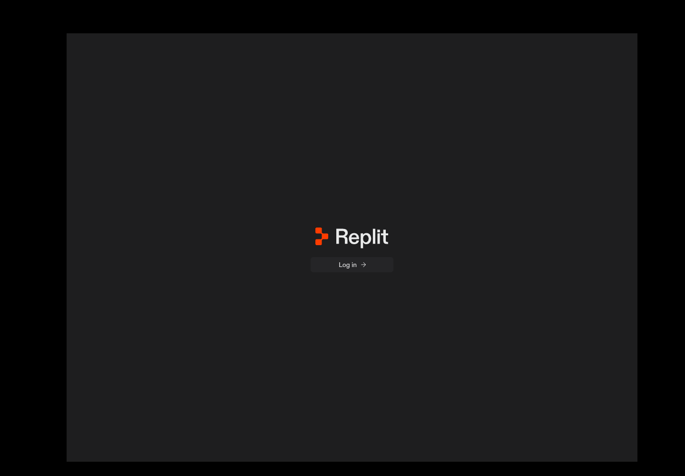

# ReplitDeck

**Created by OSINTCabal**

Version **1.0.0**.

A Replit desktop integration for **Fedora and Debian Linux (x86-64)**. Keep the existing app and open it with `replitdeck`.

[Install](docs/INSTALL.md) · [Development](docs/DEVELOPMENT.md) · [Verification](docs/VERIFICATION.md)



## Features

Use the official Replit desktop application to open projects, work in its editor, and access your Replit account. The integration adds a per-user Linux installer, desktop launcher, verified package updates, and retained runtime versions.

## How it works

The installer downloads Replit’s official Linux package and checks its SHA-512 checksum and size against the official update feed. The same package is unpacked per user on Fedora and Debian. The upstream application provides its interface and online features; this repository contains the Linux integration, not a copy of the application bundle.

Account access, online features, and usage limits are controlled by Replit. Reinstalling the integration preserves account data.

## Installation

Fedora and Debian use **one repository and the same installer**. Follow the [installation guide](docs/INSTALL.md), then run:

```bash
bash install.sh
replitdeck
```

The release verification targets are **Fedora 44 and Debian 13, x86-64**. See the [installation guide](docs/INSTALL.md) for dependencies.

## Screenshots

The signed-out start screen above uses a clean profile without account data. Sign-in is required for account-backed features.

## Notes

- This integration is unofficial and is not affiliated with Replit.
- The [MIT license](LICENSE) covers the integration source. The upstream application, artwork, and dependencies retain their own licenses.
- Browser authentication and service availability remain upstream features. See [verification](docs/VERIFICATION.md) for what was exercised.
- Runtime bundles, saved sign-ins, logs, and caches are excluded from the local Git repo.

## Coming soon

More desktop integration and broader Linux desktop testing are planned.

## Deck series

[VibeDeck](https://github.com/OSINTCabal/VibeDeck) · [GrokDeck](https://github.com/OSINTCabal/GrokDeck) · [KimiDeck](https://github.com/OSINTCabal/KimiDeck) · [MinimaxDeck](https://github.com/OSINTCabal/MinimaxDeck) · [ManusDeck](https://github.com/OSINTCabal/ManusDeck) · [CopilotDeck](https://github.com/OSINTCabal/CopilotDeck) · [DeepDeck](https://github.com/OSINTCabal/DeepDeck) · [JulesDeck](https://github.com/OSINTCabal/JulesDeck) · [MuseDeck](https://github.com/OSINTCabal/MuseDeck) · [PerplexityDeck](https://github.com/OSINTCabal/PerplexityDeck)

Part of the OSINTCabal Deck series. [OSINTCabal.org](https://OSINTCabal.org).
